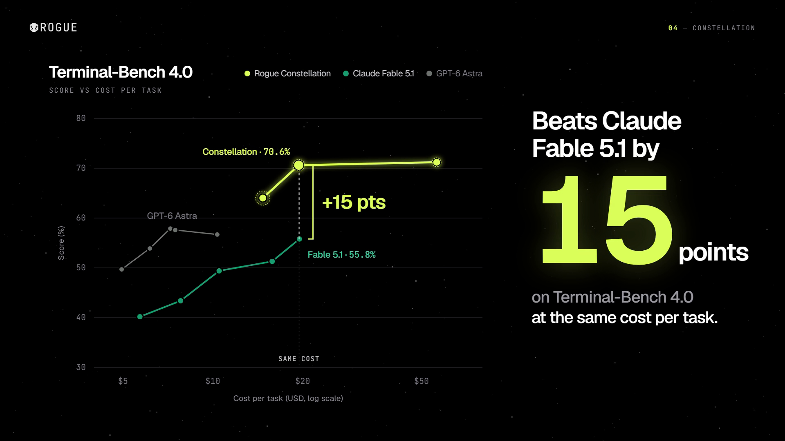

# Rogue elevator pitch video (draft)

A 63-second, 1080p60 motion video built as an HTML animation and rendered frame by frame.



## Files

| File | What it does |
| --- | --- |
| `pitch.html` | The video: scenes, copy, chart data and the animation timeline. `render(t)` draws the frame at time `t`. |
| `render.mjs` | Opens `pitch.html` in headless Chromium, steps through it at 60fps and pipes frames to ffmpeg. |
| `audio.py` | Synthesizes the sound design (`soundtrack.wav`), timed to the events in `pitch.html`. |
| `assets/` | Rogue logos and images used in the scenes. |
| `fonts/` | Geist and JetBrains Mono (SIL OFL 1.1). |
| `rogue-pitch.mp4` | The current render, with audio. |

## Requirements

- Node.js 20+ and `npm install`
- A Chromium for Playwright (`npx playwright-core install chromium`), or Google Chrome installed
- ffmpeg on `PATH`
- Python 3 with `numpy` and `scipy`

## Render

```bash
npm install
npm run render     # -> rogue-pitch-silent.mp4 (about 3 minutes)
npm run audio      # -> soundtrack.wav
npm run mux        # -> rogue-pitch.mp4
```

Preview single frames without rendering the whole video:

```bash
node render.mjs stills 3.6 21.6 40.5   # -> stills/t-3.60.png ...
```

Opening `pitch.html?t=40.5` through any local web server shows that frame, and `pitch.html?play` plays it in real time.
